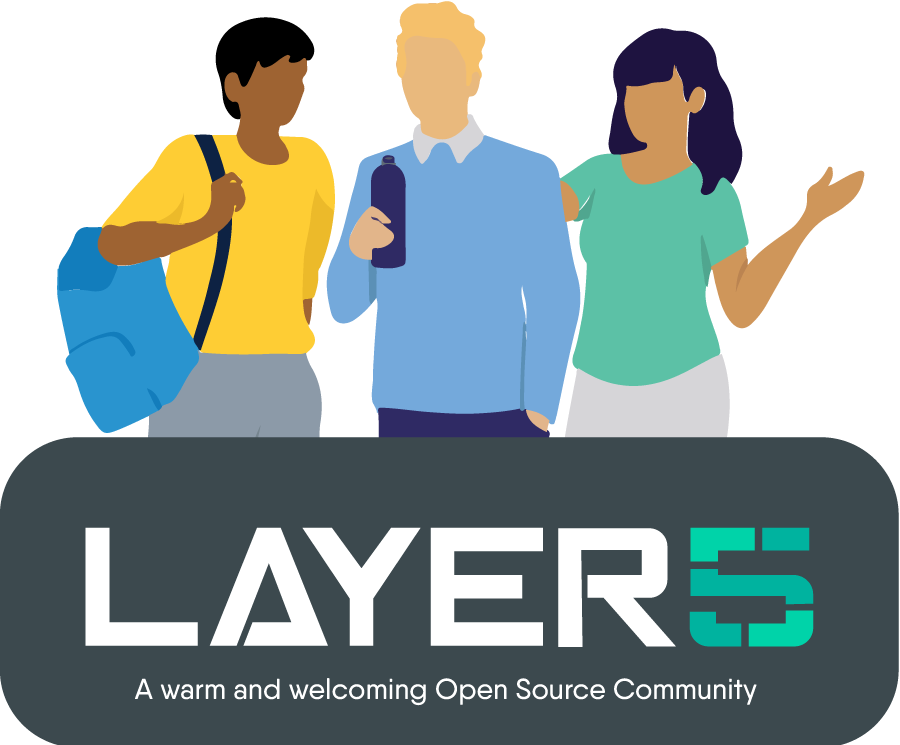

# layer5-repo-template
This repository is used as the boilerplate for consistency across all Layer5 repos.

## AI Coding Agent Instructions

This repository provides centralized instructions for AI coding agents to ensure consistency across Layer5 projects.

### Canonical Instruction File

`AGENTS.md` serves as the single source of truth for AI coding agent instructions.

### Claude Code Compatibility

`CLAUDE.md` is a symbolic link pointing to `AGENTS.md`.

This allows Claude Code and other compatible coding agents to access the same instructions without maintaining duplicate files.

### Updating Agent Instructions

Contributors should make all changes directly in `AGENTS.md`.

Do not edit `CLAUDE.md` separately or replace the symbolic link with a regular file.

Changes made to `AGENTS.md` are automatically reflected when accessing `CLAUDE.md`.

### Verifying the Symbolic Link

To verify that the symbolic link points to the correct file, run:

`readlink CLAUDE.md`

The expected output is `AGENTS.md`.

To verify that both paths provide identical content, run:

`cmp AGENTS.md CLAUDE.md`

If the files contain identical content, the command produces no output.

## PR Gate: Require no-mistakes

This template ships the no-mistakes agent skill (`skills/no-mistakes/SKILL.md`, pinned to no-mistakes `v1.106.1`) and the `Require no-mistakes` required check. Every PR must be raised through the no-mistakes pipeline: run `no-mistakes init`, then `git push no-mistakes <branch>`. Telemetry is disabled by default (`NO_MISTAKES_TELEMETRY=0`). See `AGENTS.md` for the full gate, telemetry opt-out, and drift-recovery instructions.

&nbsp;

## Join the Layer5 community!

Our projects are community-built and welcome collaboration. 👍 Be sure to see the <a href="https://layer5.io/community/newcomers">Layer5 Community Welcome Guide</a> for a tour of resources available to you and jump into our <a href="http://slack.layer5.io">Slack</a>!

<h3>Find your MeshMate</h3>

MeshMates are experienced Layer5 community members, who will help you learn your way around, discover live projects and expand your community network.
Become a <b>Meshtee</b> today!

Find out more on the <a href="https://layer5.io/community">Layer5 community</a>.  
    

&nbsp;

<a href="https://slack.layer5.io">
  <picture align="right">
    <source media="(prefers-color-scheme: dark)" srcset=".github/readme/images//slack-dark-128.png"  width="110px" align="right" style="margin-left:10px;margin-top:10px;">
    <source media="(prefers-color-scheme: light)" srcset=".github/readme/images//slack-128.png" width="110px" align="right" style="margin-left:10px;padding-top:5px;">
    
  </picture>
</a>

✔️ <em><strong>Join</strong></em> any or all of the weekly meetings on <a href="https://calendar.google.com/calendar/b/1?cid=bGF5ZXI1LmlvX2VoMmFhOWRwZjFnNDBlbHZvYzc2MmpucGhzQGdyb3VwLmNhbGVuZGFyLmdvb2dsZS5jb20">community calendar</a>. 
✔️ <em><strong>Watch</strong></em> community <a href="https://www.youtube.com/playlist?list=PL3A-A6hPO2IMPPqVjuzgqNU5xwnFFn3n0">meeting recordings</a>. 
✔️ <em><strong>Access</strong></em> the <a href="https://drive.google.com/drive/u/4/folders/0ABH8aabN4WAKUk9PVA">Community Drive</a> by completing a community <a href="https://layer5.io/newcomer">Member Form</a>. 
✔️ <em><strong>Discuss</strong></em> in the <a href="https://discuss.layer5.io">Community Forum</a>. 
✔️<em><strong>Explore more</strong></em> in the <a href="https://layer5.io/community/handbook">Community Handbook</a>. 

<i>Not sure where to start?</i> Grab an open issue with the <a href="https://github.com/issues?q=is%3Aopen+is%3Aissue+archived%3Afalse+(org%3Alayer5io+OR+org%3Ameshery+OR+org%3Ameshery-extensions+OR+org%3Alayer5labs+OR+org%3Aservice-mesh-performance+OR+org%3Aservice-mesh-patterns+OR+org%3Ameshery-extensions)+label%3A%22help+wanted%22">help-wanted label</a>.

